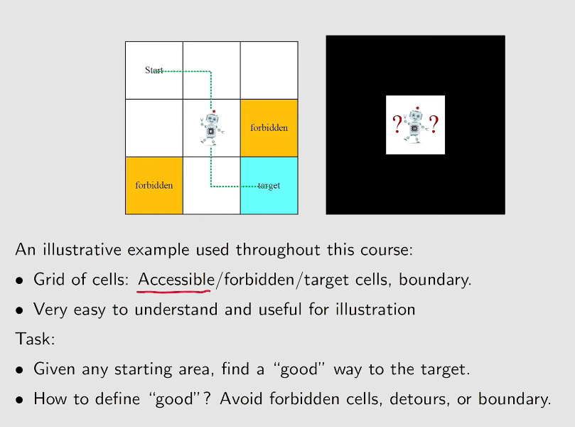
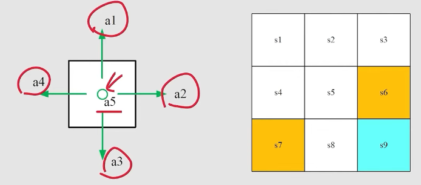
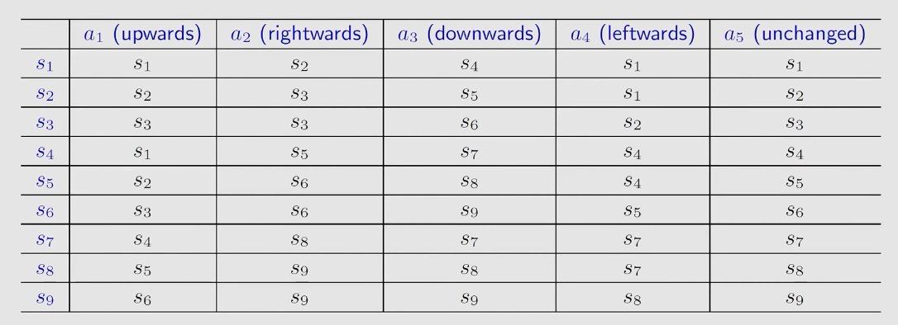
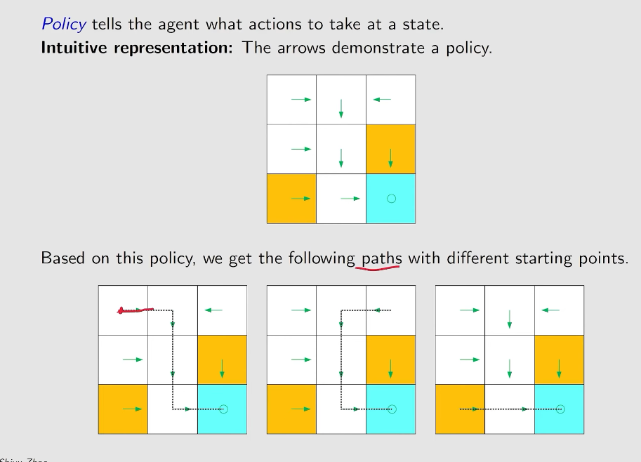
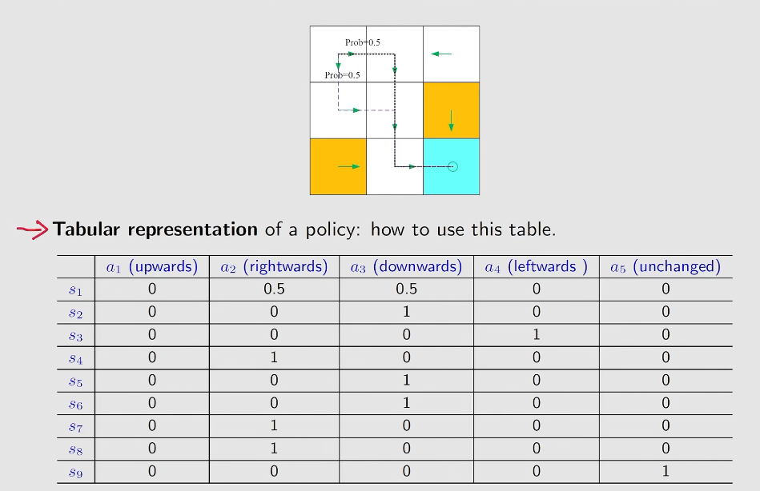
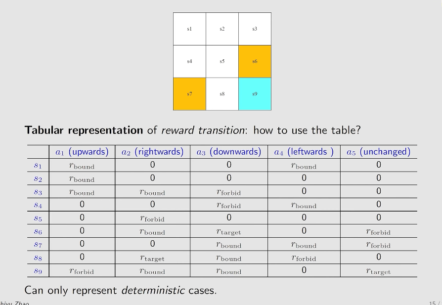
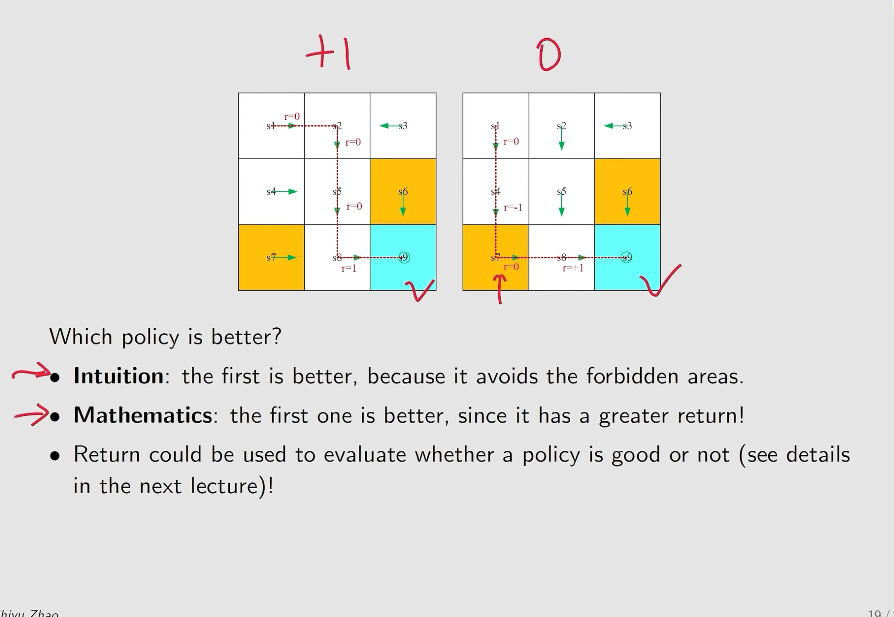
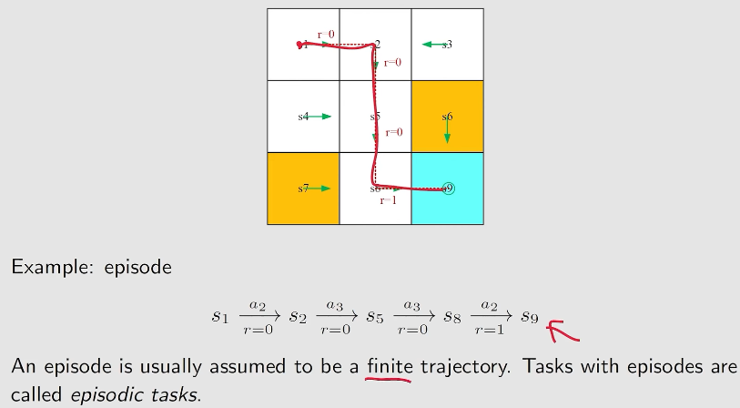
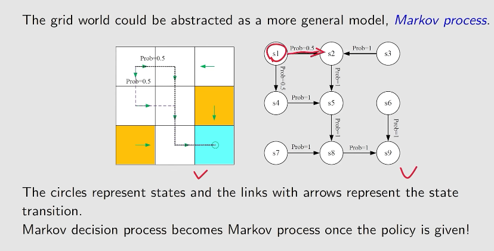

# Basic Concepts of Reinforcement Learning

## Video 1: Basic Concepts (P1 – State, Action, Policy, ...)

The robot basically can move up, down, left, or right to find a good way to the target. The Grid World will be used as an example to explain the following concepts.

### 1. State (\(s\))

The status of the agent with respect to the environment. In Grid World, the state represents the position of the robot.

\[
S = \begin{bmatrix}
X \\
Y
\end{bmatrix}
\]

- **State Space**: The set of all possible states.

\[
\mathcal{S} = \{s_i\}_{i=1}^{N}
\]

### 2. Action (\(a\))

For each state, the possible actions (\(a_1, a_2, \ldots, a_5\)) represent moving up, right, down, left, and doing nothing, respectively.

- **Action Space of a State**: The set of all possible actions available in a state.

\[
\mathcal{A}(s_i) = \{a_1, a_2, \ldots, a_5\}
\]

### 3. Forbidden Area

At state \(s_5\), if we choose action \(a_2\), what will the next state be?

There are two possible cases:

- **Case 1:** The forbidden area is accessible but comes with a penalty (challenging).
- **Case 2:** The forbidden area is inaccessible.

### 4. State Transition 

When taking an action, the agent may move from one state to another. This is called a **state transition**.

\[
s_1 \xrightarrow{a} s_2
\]

The problem with this representation is that it can only represent deterministic cases.

Use probability to describe state transitions.

\[
p(s_2 \mid s_1, a_2) = 1
\]

\[
p(s_i \mid s_1, a_2) = 0,
\quad \forall i \neq 2
\]

It is used for stochastic cases.

### 5. Policy (\(\pi\))

Tells the agent what action to take in a given state.

Another way to explain a policy is by using conditional probability:

\[
\begin{aligned}
\pi(a_1 \mid s_1) &= 0 \\
\pi(a_2 \mid s_1) &= 1 \\
\pi(a_3 \mid s_1) &= 0 \\
\pi(a_4 \mid s_1) &= 0 \\
\pi(a_5 \mid s_1) &= 0
\end{aligned}
\]

But what if the case is stochastic? It can also be represented using a tabular representation.

### 6. Reward (\(r\))

A real number we get after taking an action.

- **Positive Reward**: Represents encouragement.
- **Negative Reward**: Represents punishment.

The agent aims to get positive rewards.

#### Reward Design in Grid World

In Grid World, we designed the rewards as follows:

| Condition | Reward |
|---|---:|
| The agent attempts to get out of boundaries | \(r_{\text{bound}} = -1\) |
| The agent attempts to enter the forbidden area | \(r_{\text{bound}} = -1\) |
| The agent gets to the target cell | \(r_{\text{bound}} = +1\) |

What if the reward is stocasthic? **OFC, conditional probs again**

- Intuition: At state s_1, if we choose action a_1, the reward is -1
- Math: $p(r=-1|s_1,a_1) = 1$ and $p(r\not ={-1}|s_1,a_1) = 1$

### 7.Trajectory and Return

A trajectory is a state-action-reward chain:

$$ s_1 \xrightarrow[r=0]{a_2} s_2 \xrightarrow[r=0]{a_3} s_5 \xrightarrow[r=0]{a_3} s_8 \xrightarrow[r=1]{a_2} s_9$$

Thre return of this trajectory is a sum of all rewards collected on that tracjectory

$$return = 0+0+0+1$$

The problem is trajectory may stuck on the infinite loop

$$ s_1 \xrightarrow[r=0]{a_2} s_2 \xrightarrow[r=0]{a_3} s_5 \xrightarrow[r=0]{a_3} s_8 \xrightarrow[r=1]{a_2} s_9 \xrightarrow[r=1]{a_5} s_9 \xrightarrow[r=1]{a_5} ...$$

The return is 

$$return = 0+0+0+1+1+1+.. = \infty$$

the definition is invalid since the return diverges

### 8. Discounted Return ($\gamma \in [0,1)$)

To resolve that problem we formulate the discounted return with,

$$Discounted Return = 0 + \gamma0+ \gamma^20 + ... \\
= \gamma^3(\frac{1}{1-\gamma})
$$

- If $\gamma$ close to 0,the value of the discounted return obtained in the near future
- If $\gamma$ close to 1,the value of the discounted return obtained in the far future
  
### 9. Episode

When interacting with the environtment following a policy, the agent may stop on some terminal states. The resulting trajectory is called an episode (or a trial)

In fact, we can treat episodic and continuing tasks in a unified mathematical way by converting episodic tasks to continuing tasks

- Option 1: Treat the target state as special absorbing state. Once in, never out ($r=0$)
- Option 2: Treat the target state as a normal state with policy. The agent can still leave the target state and gain $r=+1$ when entering the target state

Option 2 may be more explainable since, do not create a new characteristic to the tile

### 10. Markov Decision Process (MDP)

Key Element of MDP:
- Sets:
  - State: Sets of state
  - Action: Sets of action $A(s)$ is associated for state $s \in S$
  - Reward: The set of rewards $R(s,a)$
- Probability Distribution
  - State transition probability: at state $s$, taking action $a$ leads to the probability to transit state $s'$ is $p(s'|s,a)$
  - Reward Probability: at state $s$, taking action $a$, the probability to get reward $r$ is $p(r|s,a)$
- Policy: at state s, the probability to choosen action $a$ is $\pi(a|s)$
- Markov Property:
$$p(s_{t+1}|a_{t+1},s_t,...,a_1,s_0) = p(s_{t+1}|a_{t+1},s_t) \\
p(r_{t+1}|a_{t+1},s_t,...,a_1,s_0) = p(r_{t+1}|a_{t+1},s_t)
$$

