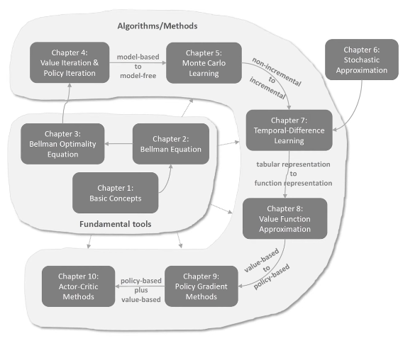

# Mathematical Foundations of Reinforcement Learning

By Shiyu Zhao

Source: https://www.youtube.com/watch?v=ZHMWHr9811U&list=PLEhdbSEZZbDaFWPX4gehhwB9vJZJ1DNm8&index=2

## Chapter on this course:

1. Chapter 1: Basic Concepts

   - State, action, reward, return, episode, policy. 
   - Markov Decision Process

2. Chapter 2: Bellman Equation & Politcy Evaluation

    - Concept (State Value) vs Tool (Bellman Equation)
    - Policy Evaluation

3. Chapter 3: Bellman Optimality Equation
   
    - Special Bellman Equation
    - Optimal Policy ($\pi$) & Optimal State Value
    - Bellman Optimality Equation as a tool

4. Chapter 4: Value Iteration & Policy Iteration

    - Value Iteration
    - Policy Iteration
    - Truncated policy iteration

5. Chapter 5: Monte Carlo Learning

    - Model-based to model-free
    - MC Basic
    - MC Exploring starts
    - MC $\epsilon$-greedy

6. Chapter 6: Stocastic Approximation

    - Non incremental to incremental
    - Mean Estimation
    - Robbins-Monro (RM) Algorithm
    - Stochastic Gradient Descent (SGD)
    - SGD, BGD, MBGD

7. Chapter 7: Temporal Distance Learning

    - TD Learning of state values
    - Sarsa: TD Learning of action values
    - Q-Learning: TD Learning of optimal action values
    - On-policy & off-policy
    - Unified POV

8. Chapter 8: Value Function Approximation

    - Function Representation
    - State Value Estimation with value function approximation (VFA)
    - Sarsa with VFA
    - Q-Learning with VFA
    - Deep Q-Learning

9. Chapter 9: Policy Gradient Methods

    - Metrics to define optimal policies
    - Policy Gradients
    - Gradient-ascent algorithm (REINFORCE)

10. Chapter 10: Action-Critic Method

    - Policy-based + value-based
    - QAC, A2C, Off-policy actor critic
    - Importance sampling
    - Deterministic actor-critic (DPG)